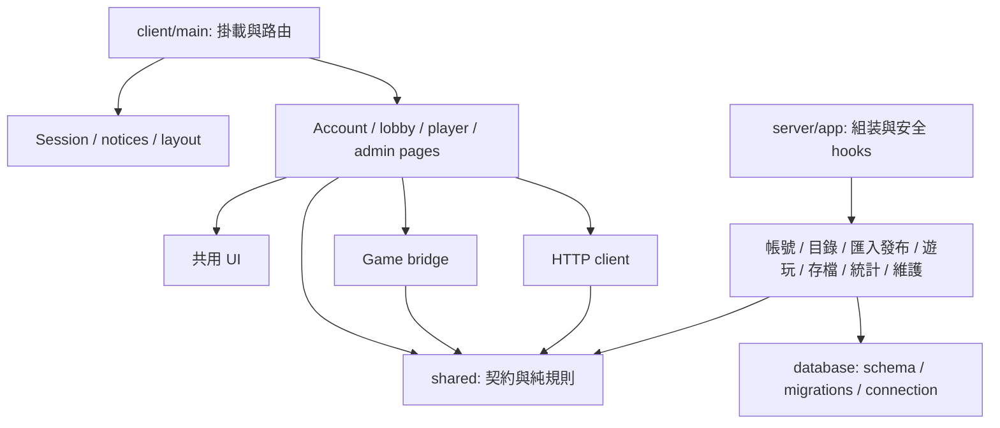

# 模組責任及依賴

此文件記錄內部邊界。外部遊戲規格、路由、權限與發布政策由各規格定義，搬移不會改變它們。

| 功能 | 擁有的資料／前端入口 | 對外操作 | 允許依賴 |
| --- | --- | --- | --- |
| 帳號與權限 | `client/features/account`、`client/account-settings.tsx`、`client/admin-accounts.tsx`；session 在 `client/environment/session.tsx` | 登入、登出、設定、權限管理、刷新 session | HTTP client、shared/account、通知、UI；其他功能只讀 session |
| 遊戲目錄 | `client/features/lobby/lobby-page.tsx`、`client/features/player/game-detail.tsx`、`client/admin-games.tsx`；列表條件在所屬頁 | 列表、搜尋、版本詳情、收藏 | HTTP client、契約、玩家 library 與 UI；不匯入入口 |
| 來源／匯入／發布 | `client/features/sources`、`client/admin-game-updates.tsx`、`client/features/admin/admin-workspace.tsx` | 新增來源、確認 Release、啟動批次、查看進度、預覽驗收、發布確認 | HTTP client、shared/sources、shared/game-updates、通知、dialog；入口頁協調已選 ID |
| 遊玩與成績 | `client/features/player/game-frame.tsx`、`play-page.tsx`、`client/career.tsx`、game bridge | 啟動 iframe、重啟、全螢幕、SDK 操作、榜單與生涯 | shared 契約、session、HTTP、UI；React 生命週期留在 client |
| 雲端存檔 | shared/cloud-save 與 game bridge；後端 cloud-save | 保存／讀取、revision 衝突、格式相容與恢復 | 契約、存檔服務及專属資料查詢；管理介面不能讀取私人 data |
| 營運統計 | `client/admin-analytics.tsx`、`admin-visitors.tsx`、`visitor-tracking.tsx` | 查詢聚合、受權限控制的紀錄、訪客事件 | HTTP、shared/analytics/visitors、UI；報表 SQL 可留在統計模組 |
| 平台維護 | `client/features/admin/platform-updates.tsx`；server/maintenance/update | OTA、備份、還原、診斷 | 維護服務、DB schema 版本、受控檔案操作；不依賴 React |

## 前端狀態與生命週期

- `main.tsx` 只建立 providers、路由及 React root。Session、通知和頁首／頁尾有獨立入口，功能頁不能反向依賴 main。
- `AddSources` 管理探索及貼上新增；`ImportWorkspace` 管理來源／Release 選取和批次提交；`BatchProgress` 管理持久化批次的觀看／重試；`ImportBatches` 管理批次列表。`admin-sources.tsx` 僅保留舊 import 路徑的 re-export。
- `usePreviewQueue` 管理預覽授權、連續驗收與佇列；`useOperationConfirmation`／`OperationConfirmation` 管理單款發布、下架及撤銷確認。列表搜尋、篩選、頁碼留在列表元件。
- 後台 workspace 以帳號／角色為 key，角色切換銷毀受限畫面；PlayerLibrary 以帳號／session CSRF 為 key。播放器保留 identity、取消 HEAD 請求、listener 與 timer cleanup。
- 匯入在伺服器持續執行；關閉匯入 dialog 只停止觀看與前端檢查，不取消已提交批次。

## 後端服務及路由入口

`server/main.ts` 建立 DB，`server/app.ts` 組裝來源 worker、session access、全域 Origin／安全 hook、錯誤回應、靜態前端及 health。帳號模組提供逐次 session／CSRF／權限檢查；組裝層將 guard 傳給各路由。關閉順序保留先解除等待中的來源檢查，再關閉 platform、assets，最後中止並等待匯入 queue。

| 模組／資料擁有者 | HTTP 入口 | 服務／讀取入口與規則 |
| --- | --- | --- |
| 帳號／session | `account-session.ts`；設定及角色仍在帳號專屬模組 | `account-session-service.ts`：登入、註冊、session 建立／撤銷、帳號及訪客身份讀取；`command-context.ts` 透過帳號讀取在交易內重查權限 |
| 遊戲／版本／發布 | `game-catalog-routes.ts`、`game-updates.ts` | `game-catalog.ts` 提供公開目錄、發布 Manifest、版本／榜單及已安裝 Release 讀取；`library.ts` 擁有版本安裝、計分規則檢查及低層發布；`game-commands.ts` 共用單款／批量發布、下架及驗收的交易規則 |
| 預覽／遊戲資源 | `game-assets.ts`，預覽授權由 `game-updates.ts` 提交 | `preview-service.ts` 擁有授權建立／過期檢查；assets 保留獨立來源、Host／CSP／CORS、安全路徑與 stream 回應；歷史已發布資源仍依遊戲上架狀態開放 |
| 來源／匯入 | `sources.ts` | `source-service.ts` 擁有來源及 GitHub owner 操作；`source-checks.ts` 維持檢查／配額排隊生命週期；`import-queue.ts` 擁有任務及下載／驗證流程並呼叫 `library.installVersion`；`import-batch-service.ts` 擁有 requestId 去重、逐項結果、交易及提交後啟動下載 |
| 管理讀取 | `admin-data.ts` | `admin-data-service.ts` 集中分頁、摘要、版本詳情、選取 hydration 與任務查詢；唯讀跨表 SQL 留在此處；舊 `admin-data.ts` 讀取 export 保留相容入口 |
| 存檔／快照 | `cloud-save.ts` | `cloud-save-service.ts` 擁有 load/save/restore、revision、requestId、快照與交易；`save-compatibility.ts` 只向發布／管理端提供格式彙總；Manifest 經遊戲讀取介面取得 |
| OTA | `platform-updates.ts` | `platform-update-service.ts` 只使用設定中的 updater URL／token、固定 action 及原本 timeout；HTTP 入口保留管理權限、commit 驗證與 202 回應 |

HTTP 入口負責輸入、guard、回應與傳輸層錯誤記錄。服務不依賴 Fastify request/reply；身份以 user ID 等明確值傳入。單款與批量匯入都使用同一 queue，批次只負責選取、去重和提交協調；單款與批量發布都使用同一發布服務。沒有新增泛用 repository 框架。

成績模組透過遊戲介面取得上架狀態、版本 Manifest 和排行榜規則；收藏寫入透過遊戲介面檢查可見性；訪客事件透過帳號／遊戲介面取得最小身份及名稱。生涯、收藏列表、管理資料和統計的跨表報表 SQL 仍留在所屬讀取模組，無需拆成多次查詢。帳號設定／角色及成績等其餘模組保持原本專屬模組內部組織，本輪不把每個 handler 都抽成新類別。

寫入擁有者在 `scripts/check-module-boundaries.ts` 明列：帳號模組寫 users/sessions/settings，來源模組寫 repositories/owners/jobs/batches，library／game-commands 寫 games/versions，preview 寫 previews，career 寫 plays/runs/best_scores，player-library 寫 favorites，cloud-save service 寫 saves/snapshots，analytics／visitors 寫各自事件表，operational-state 寫維護紀錄。唯一跨表維護例外是 migration、CLI 管理員初始化，以及備份 sanitation 清除 session／preview 並標記中斷任務；各有明確入口，沒有把整個 maintenance 模組授權為任意資料表寫入者。

此拆分保留 API、資料表、權限、發布政策、存檔衝突與匯入重啟處理。07 的安裝日誌／中斷恢復與保留規則尚未加入；02／06 的契約仍以原規格為準。

## 邊界檢查

`npm run check:boundaries` 解析 TypeScript 靜態 import、re-export 與 literal dynamic import，拒絕 runtime cycle、client 頁面匯入 main、shared 匯入 server/client、server/sdk 匯入 UI，以及共用 UI 匯入 feature。後端額外拒絕服務匯入 Fastify／已拆出的 HTTP 入口、路由直接操作 persistence，以及透過 schema import（包含 alias）或 SQL literal 寫入其他模組的資料表。schema 新增資料表必須登記寫入擁有者。CI 執行此檢查；`tests/module-boundaries.test.ts` 驗證允許所屬寫入／報表讀取、拒絕越界寫入與 HTTP 依賴。

僅型別依賴仍接受分層檢查，但不作為 runtime cycle。這是輕量靜態檢查，不是完整 SQL／TypeScript 語意分析：動態計算的 import、SQL／表名及間接 alias 需要人工 review。

## 07 安裝與維護

installation-service 擁有安裝日誌、games／versions 的匯入登記及恢復時的工作結果；import-queue 保留下載／驗證與排程責任。library 保留低階 publish，兼容轉出 installVersion／fileHash。version-files 提供安全路徑、檔案 inventory、SHA-256 與 flush，不存取資料庫。import-maintenance 提供只讀診斷／版本保留及指定孤立成品隔離；CLI 以同一資料目錄鎖排除 app 匯入。maintenance 只在備份快照清理不完整日誌、正規化已登記工作，不移動正式資料。啟動由 app 在建立 queue 之前等待 recoverInstallations。新增服務沿用 Fastify 禁入／資料表寫入 owner 檢查。
